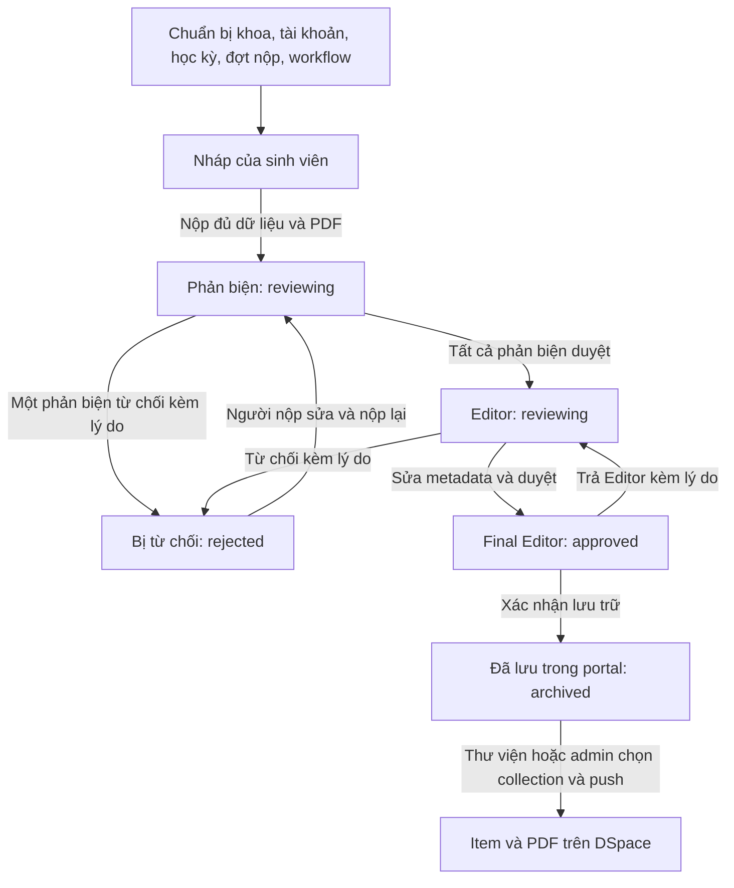

# Các flow và use case hiện có trên UI-build

Ngày đối chiếu: 10/11/2026. Nhánh thực tế: `UI-build`; HEAD lúc kiểm tra: `3d97faf3`. Phạm vi gồm source đang có trong working tree, bao gồm Swagger chưa commit. Đây là kiểm kê implementation qua frontend và backend, không phải báo cáo chạy kiểm thử toàn bộ hoặc xác nhận cấu hình database đang triển khai.

## 1. Actor và phạm vi

| Actor | Workspace và trách nhiệm mặc định |
| --- | --- |
| Khách chưa đăng nhập | Đăng nhập local hoặc Google theo cấu hình |
| Sinh viên (`student`) | Tạo nháp, nộp, theo dõi, sửa/nộp lại trong trạng thái được phép; xem hồ sơ đồng tác giả |
| Phản biện (`reviewer`) | Xử lý các hồ sơ được gán và phù hợp phân nhóm |
| Thư viện / Editor (`library_staff`) | Tiếp nhận, chỉnh metadata, duyệt/từ chối; quản lý học kỳ, đợt nộp và publish DSpace |
| Giám đốc / Final Editor (`director`) | Duyệt bước giám đốc trung gian, trả Editor hoặc xác nhận lưu trữ ở bước cuối; xem cấu hình lưu trữ |
| Quản trị viên (`admin`) | Quản trị người dùng/quyền/cấu hình; tạo và nộp hộ; quản lý hồ sơ, kho và DSpace |
| SMTP, Google, DSpace | Hệ thống ngoài phục vụ email, xác thực và xuất bản |

Quyền mặc định được seed trong `db/init/001_schema.sql`. Admin có thể sửa permission của vai trò; nhiều service vẫn kiểm tra role cụ thể và UI điều hướng theo role. Gán một permission không tự tạo ra một workspace hay cho phép vượt mọi kiểm tra role.

## 2. Luồng nghiệp vụ chính

Sơ đồ thể hiện workflow mặc định. Workflow có thể thêm, bớt, đổi thứ tự hoặc lặp vai trò. `submission_steps` lưu bản chụp các bước cho từng hồ sơ; `current_step` xác định bước hiện tại. Mỗi lần nộp/nộp lại gọi `snapshot()` theo template lúc đó. Chỉnh template không trực tiếp viết lại snapshot của hồ sơ đã nộp.

## 3. Tài khoản và các thao tác chung

| Mã | Use case | Flow hiện có |
| --- | --- | --- |
| AUTH-01 | Đăng nhập tên/mật khẩu | Mở trang → lấy login options → nhập tài khoản → xác thực → nhận JWT và user → vào workspace theo vai trò. Khi bật Google, admin vẫn đăng nhập local được. |
| AUTH-02 | Đăng nhập Google | Chọn Google → chuyển OAuth → callback kiểm tra state, email đã xác minh và domain được phép → tìm tài khoản đã được admin tạo → cập nhật tên hiển thị → trả phiên đăng nhập về frontend. Không tự đăng ký tài khoản mới. |
| AUTH-03 | Khôi phục phiên | Tải lại trang → đọc phiên trong localStorage → gọi `/auth/me` để cập nhật thông tin người dùng. |
| AUTH-04 | Đổi/đặt mật khẩu | Mở hộp đổi mật khẩu → xác nhận mật khẩu hiện tại nếu đã có → nhập mật khẩu mới → lưu. Tài khoản chưa có mật khẩu có thể đặt mật khẩu. |
| AUTH-05 | Đăng xuất | Chọn đăng xuất → xóa phiên localStorage và trạng thái frontend → trở về trang đăng nhập. |
| COMMON-01 | Đổi ngôn ngữ | Chọn tiếng Việt/Anh trên thanh đầu trang → cập nhật nhãn giao diện. |
| COMMON-02 | Xem chi tiết hồ sơ | Mở hồ sơ có quyền xem → đọc metadata, danh sách file, PDF và timeline xử lý. |
| COMMON-03 | Xem/mở/tải PDF | Chọn file → gọi endpoint bảo vệ bằng JWT → preview PDF nhiều trang hoặc mở/tải file. |
| COMMON-04 | Xem lịch sử | Mở lịch sử → API kiểm tra người nộp/đồng tác giả, reviewer được gán hoặc staff có quyền → xem người xử lý, thời gian, nhận xét và thay đổi metadata. |

Đăng nhập bị chặn khi tài khoản disabled; maintenance mode chỉ cho admin đăng nhập. Không thấy flow tự đăng ký, quên mật khẩu qua email hoặc refresh token. JWT hiện cấu hình hết hạn sau 1 giờ.

## 4. Sinh viên

| Mã | Use case | Flow hiện có |
| --- | --- | --- |
| STU-01 | Chọn bối cảnh nộp | Lấy khoa theo tài khoản → chọn học kỳ → chọn đợt nộp đang mở và trong khoảng thời gian. Với field native mặc định, backend kiểm tra đợt thuộc khoa sinh viên. |
| STU-02 | Khai báo luận văn | Điền metadata theo form cấu hình, tác giả/đồng tác giả, reviewer được phép, PDF và các field bổ sung. |
| STU-03 | Lưu nháp | Điền dữ liệu một phần → lưu nháp → nhận hồ sơ `draft` → mở lại để tiếp tục. PDF và dữ liệu đầy đủ được kiểm tra lúc nộp. |
| STU-04 | Sửa nháp | Mở nháp → sửa metadata/tác giả/reviewer/đợt nộp → thay PDF nếu cần → lưu. |
| STU-05 | Nộp mới hoặc nộp từ nháp | Kiểm tra dữ liệu bắt buộc, PDF, tác giả, reviewer, giới hạn hồ sơ và đợt nộp → lưu hồ sơ → snapshot workflow → chuyển bước đầu → thông báo. Có cả API tạo và nộp trực tiếp lẫn nộp nháp đã có. |
| STU-06 | Theo dõi hồ sơ | Vào My submissions → xem hồ sơ mình nộp hoặc có tên tác giả → đọc trạng thái, reviewer, quyết định và lịch sử. |
| STU-07 | Sửa hồ sơ đang chờ | Nếu `reviewing` và chưa reviewer nào quyết định → người nộp được sửa/lưu hoặc nộp lại. Nếu đã có quyết định thì bị khóa các thao tác này ở trạng thái `reviewing`. |
| STU-08 | Rút về nháp | Hồ sơ `reviewing`, mọi reviewer còn pending → xác nhận rút → chuyển về `draft` → tiếp tục chỉnh sửa. |
| STU-09 | Sửa và nộp lại khi bị từ chối | Đọc lý do → sửa dữ liệu/PDF → nộp lại cùng hồ sơ → thay danh sách reviewer nếu được phép → snapshot workflow mới và bắt đầu lại. |
| STU-10 | Sửa/nộp lại hồ sơ approved | Code hiện cho người nộp sửa và nộp lại ở `approved`; nộp lại đưa hồ sơ theo workflow snapshot mới. Đây là hành vi hiện có cần xem xét nếu nghiệp vụ muốn khóa tại bước giám đốc. |
| STU-11 | Xóa hồ sơ | Người nộp xóa nháp, hồ sơ bị từ chối hoặc hồ sơ reviewing chưa có quyết định → xác nhận → xóa hồ sơ và file local. |
| STU-12 | Xem với tư cách đồng tác giả | Hồ sơ xuất hiện trong danh sách → xem chi tiết/file/lịch sử; chỉ người nộp có quyền quản lý nội dung. |

### Quy tắc thao tác của người nộp

| Trạng thái | Sửa/lưu | Xóa | Rút về nháp | Nộp/nộp lại |
| --- | --- | --- | --- | --- |
| draft | Có | Có | Không | Có |
| reviewing, mọi reviewer pending | Có | Có | Có | Có |
| reviewing, đã có quyết định reviewer | Không | Không | Không | Không |
| rejected | Có | Có | Không | Có |
| approved | Có | Không | Không | Có |
| archived | Không | Không | Không | Không |

Bảng áp dụng cho người nộp và còn chịu các điều kiện khác của hồ sơ. Đồng tác giả chỉ xem. Backend chặn tạo/nộp luận văn thứ hai nếu sinh viên đã là người nộp hoặc tác giả của một hồ sơ không phải draft, kể cả rejected/archived. Khi nộp, draft của các tác giả liên quan được dọn theo implementation. Giao diện khóa đổi đợt của hồ sơ đã nộp; nháp được đổi.

PDF mặc định tối đa 30 MB; giới hạn nghiệp vụ lấy từ `thesis_max_file_size_mb`. Form có thể bật/tắt/đổi kiểu các trường native nên một số yêu cầu tác giả/reviewer/đợt nộp còn phụ thuộc cấu hình form.

## 5. Phản biện

| Mã | Use case | Flow hiện có |
| --- | --- | --- |
| REV-01 | Xem hàng đợi phản biện | Đăng nhập reviewer → lấy hồ sơ được gán và phù hợp group grants → tìm kiếm/lọc học kỳ, đợt → xem nhóm chờ quyết định, đã duyệt, đã từ chối. |
| REV-02 | Đọc hồ sơ trước quyết định | Mở chi tiết → đọc metadata, PDF, các file và lịch sử. |
| REV-03 | Duyệt học thuật | Hồ sơ đang ở bước reviewer, quyết định của reviewer còn pending → approve → ghi quyết định và lịch sử → nếu còn reviewer pending thì chờ; nếu tất cả duyệt thì tiến bước kế tiếp. |
| REV-04 | Từ chối học thuật | Mở hộp từ chối → nhập lý do bắt buộc → reject → hồ sơ `rejected` → sinh viên nhận lý do và có thể sửa/nộp lại. |

Reviewer không archive, không trả Editor và không sửa metadata bằng luồng Editor. Quyết định đã hoàn tất không được gửi lại trong cùng lượt; khi vào bước reviewer/nộp lại, quyết định được reset theo workflow.

## 6. Thư viện / Editor

| Mã | Use case | Flow hiện có |
| --- | --- | --- |
| EDIT-01 | Tiếp nhận hồ sơ | Vào Intake & submissions → xem queue đang đến bước thư viện → tìm kiếm/lọc → mở hồ sơ. |
| EDIT-02 | Chỉnh metadata | Hồ sơ đang `reviewing` tại bước `library_staff` → chọn Edit metadata → sửa → validate → lưu transaction → ghi diff từng trường vào lịch sử. UI có tiêu đề Việt/Anh, GVHD, ngành, năm, abstract, keywords. |
| EDIT-03 | Duyệt tiếp nhận | Kiểm tra nội dung → approve → tiến bước tiếp theo; mặc định đến Final Editor và `approved` → gửi thông báo. |
| EDIT-04 | Từ chối tiếp nhận | Nhập lý do bắt buộc → reject → hồ sơ `rejected` → thông báo cho sinh viên sửa/nộp lại. |

Editor chỉ sửa metadata ở đúng bước đang xử lý; save không thay đổi dữ liệu sẽ không tạo sự kiện diff giả. Thư viện còn có các use case dùng chung về xem/xóa hồ sơ, cấu hình học kỳ/đợt và DSpace bên dưới.

## 7. Giám đốc / Final Editor

| Mã | Use case | Flow hiện có |
| --- | --- | --- |
| DIR-01 | Xem queue chờ giám đốc | Vào Approval workflow → tìm kiếm/lọc → mở metadata, PDF và lịch sử. |
| DIR-02 | Trả Editor | Nhập lý do bắt buộc → tìm bước `library_staff` gần nhất phía trước → chuyển hồ sơ về bước đó với `reviewing` → giữ file và quyết định học thuật → ghi lịch sử và báo thư viện. Không có Editor trước đó thì báo lỗi. |
| DIR-03 | Duyệt bước giám đốc trung gian | Khi workflow có director chưa phải bước cuối → approve → tiến bước tiếp theo. |
| DIR-04 | Lưu trữ trong portal | Tại director cuối → mở xác nhận Commit/Archive → xác nhận → trạng thái `archived` → ghi lịch sử, báo sinh viên; API trả `dspaceDeferred: true`. |

Director hiện không có luồng reject trực tiếp về sinh viên. Archive trong portal không tự xuất bản lên DSpace và chưa có quy trình ký số hoàn chỉnh. Tab cấu hình kho của director ở chế độ chỉ đọc.

## 8. Tra cứu và quản lý hồ sơ toàn hệ thống

Actor mặc định: thư viện, giám đốc và admin, theo permission tương ứng.

| Mã | Use case | Flow hiện có |
| --- | --- | --- |
| LIST-01 | Xem toàn bộ hồ sơ | Mở All submissions → tải danh sách → mở chi tiết, file và lịch sử. |
| LIST-02 | Tìm kiếm, lọc và làm mới | Nhập từ khóa → lọc học kỳ/đợt → xem kết quả; Refresh hoặc Retry khi tải lỗi. |
| LIST-03 | Xuất danh sách | Lọc danh sách → Export submissions → tải `submissions.csv` từ tập kết quả hiện tại. |
| LIST-04 | Xóa hồ sơ bởi staff | Mở chi tiết → xác nhận xóa → nếu có DSpace item thật thì thử xóa item → xóa hồ sơ và file portal. Nếu DSpace lỗi, có thể vẫn xóa portal và trả cảnh báo. Áp dụng cả archived. |
| LIST-05 | Admin tạo/nộp hộ | Chọn sinh viên → lấy khoa theo sinh viên → khai báo metadata/tác giả/reviewer/PDF → lưu hoặc nộp hộ; sự kiện ghi actor admin và sinh viên được nộp hộ. |
| LIST-06 | Admin sửa hồ sơ | Mở form sửa hồ sơ của sinh viên → cập nhật bằng API chung và chịu điều kiện trạng thái của backend; ngoài ra admin được sửa metadata ở bước Editor. Nhãn UI nhắc archived không đồng nghĩa API sửa form chung chấp nhận archived. |

Admin không trực tiếp approve/reject/archive bằng các endpoint reviewer/library/director vì service kiểm tra role cụ thể.

## 9. Khoa, học kỳ và đợt nộp

UI: admin quản lý khoa; admin và thư viện quản lý semester/period; director xem. API quản lý khoa cũng cho permission `library_intake`, rộng hơn nút quản lý khoa trên UI.

| Mã | Use case | Flow hiện có |
| --- | --- | --- |
| ARCH-01 | Duyệt cây và thống kê | Mở Browse & periods → bung/thu khoa → học kỳ → đợt → mở chi tiết và các số đếm hồ sơ/đợt theo đối tượng. |
| ARCH-02 | Tạo khoa | Add faculty → nhập tên → lưu khoa active trong portal. |
| ARCH-03 | Sửa/vô hiệu hóa khoa | Mở chi tiết → sửa tên/trạng thái active hoặc inactive → lưu. |
| ARCH-04 | Xóa khoa | Xác nhận → kiểm tra còn tài khoản student/reviewer gắn khoa không → nếu hợp lệ, gỡ liên kết đợt khỏi hồ sơ và xóa cây semester/period local rồi khoa. Có tài khoản liên quan thì rollback/báo lỗi. |
| ARCH-05 | Tạo học kỳ cho một khoa | Chọn khoa active → nhập tên → trim và validate → kiểm tra trùng không phân biệt hoa/thường trong khoa → tạo học kỳ. |
| ARCH-06 | Tạo học kỳ cho mọi khoa | Chọn for all faculties → nhập tên → tạo cho từng khoa active → bỏ qua khoa đã có → trả số lượng và danh sách created/skipped. |
| ARCH-07 | Sửa/xóa học kỳ | Sửa tên/trạng thái; hoặc xác nhận xóa → gỡ liên kết hồ sơ khỏi các đợt → xóa các đợt và học kỳ trong portal. |
| ARCH-08 | Tạo đợt nộp | Chọn khoa/học kỳ → nhập tên, khoảng thời gian, allowResubmit → nếu có root community cấu hình thì gọi tạo collection DSpace → lưu đợt draft; có tùy chọn mở ngay sau tạo. |
| ARCH-09 | Sửa đợt nộp | Mở chi tiết → sửa các trường được hỗ trợ (tên, thời gian, allowResubmit) → kiểm tra mở trước đóng → lưu. |
| ARCH-10 | Mở/đóng/mở lại đợt | draft/closed → open; draft/open → closed. Để nộp mới, đợt vừa phải open vừa nằm trong khoảng opensAt/closesAt. |
| ARCH-11 | Xóa đợt nộp | Xác nhận → thử xóa DSpace collection liên kết → gỡ liên kết đợt khỏi submissions → xóa đợt local; trả kết quả/cảnh báo DSpace. |

Đổi ngày mở/đóng không tự thay cột status bằng một scheduler. Kiểm tra nhận bài dùng điều kiện thời gian ngay khi truy vấn/nộp.

## 10. DSpace

| Mã | Use case | Flow hiện có |
| --- | --- | --- |
| DSP-01 | Cấu hình kết nối | Admin mở DSpace settings → nhập REST base URL, user/password → lưu system settings. Root community và token còn được backend hỗ trợ nhưng đang ẩn trong panel này. |
| DSP-02 | Chẩn đoán kết nối | API `GET /archive-config/dspace/diagnose` kiểm tra kết nối/cấu hình; không phải một bước phê duyệt hồ sơ. |
| DSP-03 | Đồng bộ cây | Admin/thư viện chọn Sync from DSpace → đọc descendants root đã cấu hình; nếu không có/root không đọc được thì fallback top-level → lưu snapshot community/collection vào `dspace_sync_nodes`. |
| DSP-04 | Duyệt kho ngoài | Xem cây đã sync → bung/thu node → mở liên kết duyệt collection khi có URL. |
| DSP-05 | Đẩy hồ sơ sang DSpace | Vào Push to DSpace → lọc khoa/học kỳ/đợt/trạng thái publish → chọn hồ sơ approved hoặc archived → chọn collection → push → tạo item, map metadata từ form fields, upload PDF → lưu item ID và kết quả từng hồ sơ. |
| DSP-06 | Gửi lại/khắc phục publish | Chọn lại hồ sơ chưa publish → push lại. Nếu item thật đã có, backend đi nhánh xử lý item hiện có/thử upload PDF thay vì luôn tạo item mới. |

Các giới hạn thực tế: sync hiện chỉ lưu cây DSpace, không tự tạo/map khoa-học kỳ-đợt trong portal (`matched*` trả mảng rỗng). Endpoint provision faculty hiện chỉ trả bản ghi khoa, không provision community. Publish lỗi hiện thường giữ `pending`; việc có item/published hoặc `ok` chưa đảm bảo PDF đã upload, cần xem `bitstreamUploaded` và thông điệp. Backend cho phép push cả `approved`, chưa bắt buộc phải `archived`.

## 11. Quản trị người dùng

| Mã | Use case | Flow hiện có |
| --- | --- | --- |
| USER-01 | Xem/tìm người dùng | Mở Manage users → tải danh sách → tìm kiếm/lọc theo các lựa chọn trên UI → xem role, khoa, trạng thái. |
| USER-02 | Tạo tài khoản | Nhập username, tên, mật khẩu, role, khoa → validate → tạo active. Student và reviewer bắt buộc có khoa. |
| USER-03 | Sửa tài khoản | Mở editor → sửa tên, role, khoa hoặc mật khẩu theo nhu cầu → validate và lưu. |
| USER-04 | Khóa/mở tài khoản | Chuyển disabled/active → lưu; disabled bị chặn đăng nhập. |
| USER-05 | Xóa tài khoản | Xác nhận → kiểm tra tài khoản hiện tại/admin cuối/liên kết submissions/reviews → xóa nếu hợp lệ, hoặc yêu cầu vô hiệu hóa thay vì xóa. |
| USER-06 | Xuất người dùng | Export → backend tạo và trả `users.xlsx`. |
| USER-07 | Tải mẫu import | Tải `users-import-template.xlsx` → điền theo mẫu hoặc chuẩn bị CSV/XLSX hỗ trợ. |
| USER-08 | Import có preview | Upload file → parser chuẩn hóa → xem dòng hợp lệ/trùng/lỗi → chọn khoa bổ sung nếu thiếu → xác nhận → tạo các tài khoản hợp lệ → xem số lượng và lỗi → làm mới danh sách. Có trường hợp import không có password để dùng Google. |

Admin không được tự xóa, tự vô hiệu hóa hoặc đổi role của chính mình. API xóa bảo vệ admin active cuối và chặn tài khoản đã có hồ sơ nộp/quyết định phản biện.

## 12. Cấu hình quản trị

| Mã | Use case | Flow hiện có |
| --- | --- | --- |
| CONF-01 | Phân quyền theo vai trò | Mở Manage roles → bật/tắt các permission có sẵn → lưu → cập nhật role_permissions và xóa cache quyền tương ứng. Bộ role/permission là danh mục cố định; không có API tạo role mới. |
| CONF-02 | Cấu hình workflow | Thêm bước reviewer/library_staff/director → đặt nhãn → đổi thứ tự/xóa/lặp role → lưu template; tối thiểu một bước. Hồ sơ đã snapshot giữ luồng cũ cho đến khi được nộp lại. |
| CONF-03 | Tạo/xóa nhóm | Tạo group student hoặc reviewer → đặt tên → lưu; xóa group khi không dùng. |
| CONF-04 | Gán thành viên và phạm vi phản biện | Chọn thành viên đúng role → lưu → chọn các student group mà reviewer group được review → lưu grant. Khi chưa có grant nào, không áp hạn chế group; khi có grant, lựa chọn/queue/hành động reviewer bị lọc theo nhóm. |
| CONF-05 | Cấu hình form nộp | Thêm/sửa/xóa field → cấu hình key, label, type, required, enabled, default, options, thứ tự và DSpace metadata path → lưu → form/validation/publish sử dụng cấu hình. Kiểu có text, textarea, select, year, file; việc khai báo kiểu file không tự có nghĩa là có một luồng upload nhiều file tùy ý ngoài thesis PDF. |
| CONF-06 | Cấu hình hệ thống | Sửa các key được hỗ trợ, gồm giới hạn PDF, timezone, số liên hệ, maintenance, phương thức login → lưu settings. Tác dụng cụ thể phụ thuộc nơi code đọc từng key. |
| CONF-07 | Cấu hình email | Bật/tắt gửi → khai báo SMTP → chỉnh subject/body template các sự kiện → lưu → sự kiện nghiệp vụ tiếp theo sử dụng cấu hình. Không có endpoint gửi email test riêng trong controller hiện tại. |

## 13. Email tự động

| Trigger mặc định | Người nhận |
| --- | --- |
| Nộp/nộp lại | Sinh viên; reviewer được gán khi bước đầu là reviewer |
| Reviewer duyệt/từ chối | Sinh viên |
| Mọi reviewer duyệt | Thư viện và sinh viên |
| Thư viện duyệt | Giám đốc và sinh viên |
| Thư viện từ chối | Sinh viên kèm lý do |
| Giám đốc trả Editor | Thư viện kèm lý do |
| Giám đốc archive | Sinh viên |

Backend gọi WorkflowMailService sau thay đổi nghiệp vụ. Gửi thất bại được log; không rollback quyết định đã commit. SMTP, toggle email và thông tin người nhận phải hợp lệ. Workflow tùy biến có thể không có đủ notification tương ứng mọi cách sắp bước.

## 14. Flow kỹ thuật hỗ trợ

- Swagger `/docs`: đăng nhập qua `/auth/login` → lấy token → Authorize → thử API; OpenAPI tại `/docs-json`. Phần này đang có trong working tree chưa commit.
- Health: gọi `/` hoặc `/health` để kiểm tra backend phản hồi.
- Khởi tạo database Docker: volume trống → chạy `db/init` → backend-seed theo marker lần đầu → backend khởi động và `ensurePortalSchema()`. Chưa có migration version/history/rollback.

## 15. Các điểm cần phân biệt với nghiệp vụ dự kiến

1. `approved` là trạng thái trước archive trong workflow mặc định; chưa đồng nghĩa đã lưu trữ hay đã đưa lên DSpace.
2. `reviewing` bao gồm reviewer và Editor; cần đọc `current_step_role` để biết đang ở bước nào.
3. Sinh viên hiện được sửa/nộp lại `approved`; không nên mô tả hệ thống đã khóa hoàn toàn sau khi thư viện duyệt.
4. Có field và hàm kiểm tra `allowResubmit`, nhưng `assertPeriodAllowsResubmit()` chưa được gọi từ flow nộp lại. Nhánh resubmit không kiểm tra open/time giống nộp nháp; không nên khẳng định tắt cờ hoặc đóng đợt sẽ chặn nộp lại hiện nay.
5. Giới hạn một luận văn hiện tính mọi hồ sơ không phải draft và cả vai trò đồng tác giả, không chỉ hồ sơ đang xử lý.
6. DSpace sync không tự sinh cấu trúc portal; tạo faculty/semester local không có nghĩa đã tạo community DSpace.
7. Publish DSpace cho cả approved và archived; lỗi và thiếu PDF cần đọc kết quả chi tiết, không chỉ nhãn trạng thái.
8. Chưa có ký số hoàn chỉnh, self-registration, forgot-password email, tạo role mới hoặc migration history qua API/UI hiện có.
9. UI phân vai và API permission không hoàn toàn đồng nhất. Ví dụ UI quản lý khoa chỉ dành admin nhưng API cũng nhận library_intake; admin có nút sửa hồ sơ nhưng service sửa form vẫn kiểm tra trạng thái.

## 16. Source chính để đối chiếu

- [Điều hướng theo vai trò](../frontend/src/features/submissions/components/SubmissionsDashboard.jsx)
- [Quyền thao tác của sinh viên](../backend/src/submissions/submission-student-access.ts)
- [Nộp, sửa, nộp lại, xóa và metadata](../backend/src/submissions/submissions.service.ts)
- [Duyệt và trả Editor](../backend/src/reviews/reviews.service.ts)
- [Workflow và snapshot](../backend/src/workflow/workflow.service.ts)
- [Nhóm và grants](../backend/src/workflow/groups.service.ts)
- [API quản trị](../backend/src/admin/admin.controller.ts)
- [Cấu hình kho/semester/period](../backend/src/archive/archive-config.service.ts)
- [DSpace sync](../backend/src/archive/dspace-sync.service.ts)
- [DSpace publish](../backend/src/archive/dspace-publish.service.ts)
- [Đăng nhập và đổi mật khẩu](../backend/src/auth/auth.service.ts)
- [Email workflow](../backend/src/mail/workflow-mail.service.ts)
