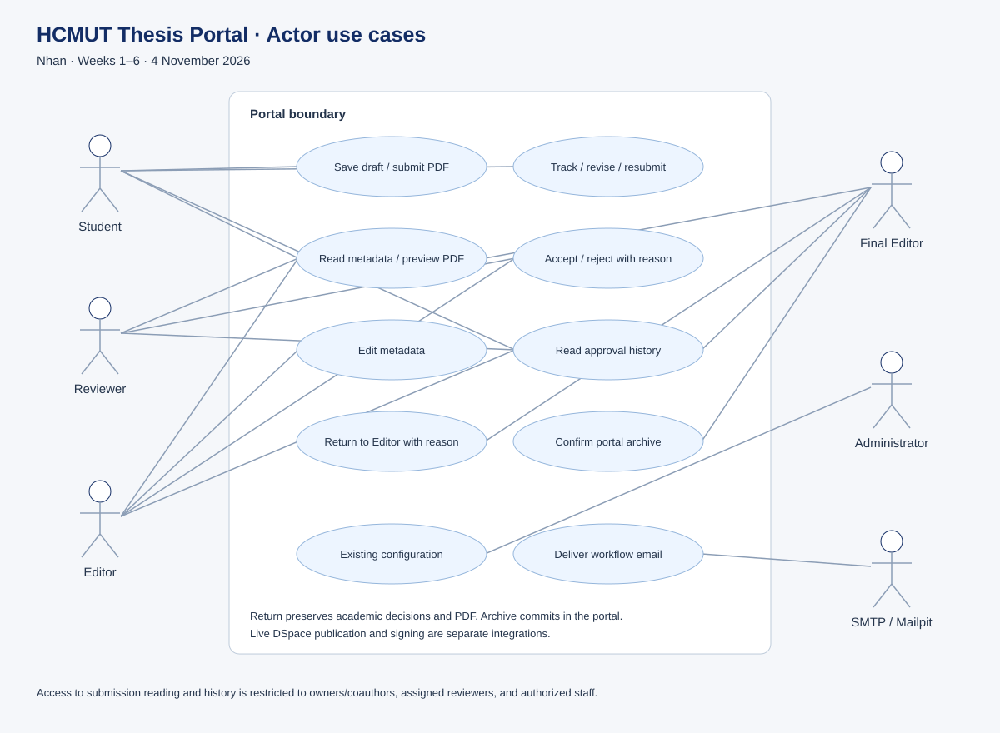
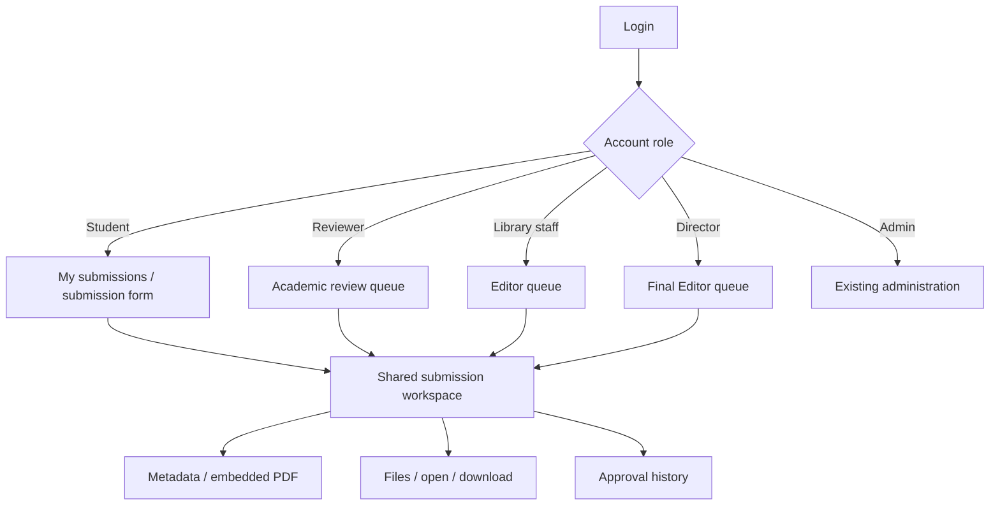
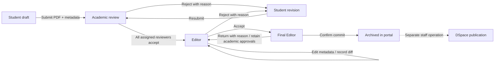
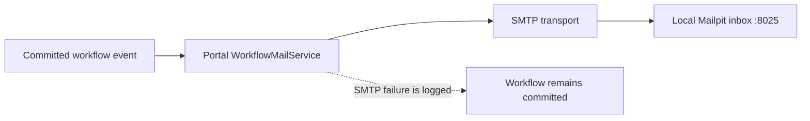

# UI, workflow, and email flows

These diagrams document the default Student -> Reviewer -> Editor -> Final Editor chain. The application retains configurable workflow snapshots; returning from a director selects the nearest earlier library_staff step. Missing earlier Editor steps produce an error rather than silently rejecting to the student.

## Actor use cases



Editable UML source: [use-cases.puml](diagrams/use-cases.puml).

## UI navigation



## Submission and review state flow



Final Editor does not reject to the student. Portal status `reviewing` spans both academic and Editor stages; `current_step_role` distinguishes them. The default final director stage uses `approved` before archive. Signing is an outstanding team integration and is not represented as completed by this flow.

## Metadata edit and return sequence

```mermaid
sequenceDiagram
  actor E as Editor
  participant UI as React workspace
  participant API as NestJS
  participant DB as PostgreSQL
  participant Mail as SMTP / Mailpit
  actor F as Final Editor
  E->>UI: Edit metadata and save
  UI->>API: PATCH /submissions/:id/metadata
  API->>DB: Lock submission; check active Editor; update changed fields + audit diff
  DB-->>API: Commit
  API-->>UI: ok + changes
  UI->>API: Refresh queue/history
  E->>UI: Accept
  UI->>API: POST library-action / approve
  API->>DB: Advance to Final Editor
  API-->>Mail: Notify director and student (best effort)
  F->>UI: Return to Editor + reason
  UI->>API: POST director-action / return_to_editor
  API->>DB: Lock; move to prior Editor; append history; preserve files/reviews
  API-->>Mail: Notify library staff with reason
  API-->>UI: ok
  E->>UI: Correct and accept again
  F->>UI: Confirm Commit to Archive
  UI->>API: POST director-action / archive
  API->>DB: Mark archived in portal
  API-->>Mail: Notify student
  API-->>UI: ok + dspaceDeferred=true
```

## Notification flow and recipients



| Trigger | Recipients | Expected message / UI destination |
|---|---|---|
| Submission | Student and assigned reviewers | Confirmation; reviewer task queue |
| Academic accept/reject | Student | Decision and rejection reason where applicable |
| Every reviewer accepts | Library staff and student | Editor intake / progress |
| Editor accepts | Director and student | Final approval queue / progress |
| Editor rejects | Student | Reason and revision/resubmission |
| Director returns | Library staff | Return reason; existing academic approvals preserved |
| Director archives | Student | Portal archive confirmation |

These are portal-generated workflow emails. Mailpit is local evidence of SMTP delivery, not proof of production mailbox delivery or a DSpace-generated notification. A portal success message does not guarantee SMTP delivery; inspect the inbox/logs for mail evidence.
