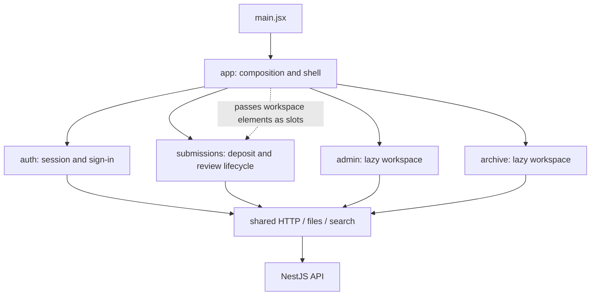

# Frontend architecture and refactor

Implemented on 4 November 2026. This refactor keeps React 18, Ant Design 5, the existing API contracts, Vietnamese/English labels, and the weeks 1–6 UI implementation.

## What changed

The application previously mixed authentication, role navigation, forms, queues, downloads, decisions, and administration in three large files. Those responsibilities now belong to four features. The application layer composes their public interfaces.

Counts below compare the working source immediately before this refactor with the compatibility entry points after it. They measure entry-point size, not deleted functionality or a reduction in total project lines.

| Original file | Before | After | Implementation entry point |
|---|---:|---:|---|
| `src/App.jsx` | 3,643 | 1 | `src/app/PortalApp.jsx` (61 lines) |
| `src/AdminPanel.jsx` | 1,722 | 25 | `src/features/admin/AdminWorkspace.jsx` (83 lines) |
| `src/LibraryArchivePanel.jsx` | 2,080 | 14 | `src/features/archive/ArchiveWorkspace.jsx` (28 lines) |

The largest remaining module is the submission table-column builder at 521 lines. State, requests, effects, and JSX have been extracted into separate modules rather than moved into another monolithic hook.

## Source map

```text
src/
  App.jsx                      Compatibility entry point
  app/
    PortalApp.jsx              Providers, role composition, lazy feature loading
    PortalShell.jsx            HCMUT header, language, account controls
  features/
    auth/
      index.js                 Public feature interface
      SessionContext.jsx       Application session
      useAuthSession.js        Restore/login/OAuth/logout/password lifecycle
      LoginPanel.jsx
      PasswordDialog.jsx
      api.js
    submissions/
      index.js                 Public feature interface and feature stylesheet
      SubmissionProvider.jsx   Composes focused controllers
      SubmissionContext.jsx    Feature-scoped view model
      api.js                   Submission, review, deposit lookup endpoints
      hooks/                   Schema, permissions, data, queues, files,
                               selection, mutations, decisions, columns, effects
      model/                   Access rules, filtering, people, files, defaults
      components/              Role dashboards, detail, filters, dialogs,
                               collection form, metadata, upload, form actions
      workflow/                Shared review workspace, PDF.js, metadata editor,
                               audit history and task queue
    admin/
      index.jsx                Explicit administration/fields/email variants
      AdminWorkspace.jsx
      AdminProvider.jsx
      AdminContext.jsx
      api.js
      hooks/                   Users/imports, permissions, settings, fields, groups
      components/              Panels, dialogs and setting controls
      model/                   Role and setting definitions
    archive/
      index.jsx                Explicit management/browse variants
      ArchiveWorkspace.jsx
      ArchiveProvider.jsx
      ArchiveContext.jsx
      api.js
      hooks/                   Hierarchy, configuration, details, DSpace and sync
      components/              Browse/publish/settings panels and dialogs
      model/                   Date and setting helpers
  shared/
    api/http.js                Authorization, response parsing, native fetch
    files/csv.js               CSV downloads
    search.js                  Search normalization
  i18n/                        Existing language infrastructure
  workflow/                    Compatibility exports to submissions/workflow
```

## Dependency and state boundaries



- Import other features only from the application layer and through their `index` entry points. Features do not import one another.
- Admin and archive workspaces are passed into submission dashboards as React elements. The submissions feature does not depend on their implementations.
- Authentication and language are application-wide. Submission, admin, and archive state live within their respective providers. Each controller receives only the bindings it uses.
- Submissions and review remain one feature because draft editing, academic approval, library editing, return, and archive share one thesis lifecycle.
- The authenticated workspace is keyed by username and role. Logout unmounts its providers; a new login starts fresh form, filter, modal, and queue state.
- `api.js` owns feature requests. Shared transport returns the native `Response`, preserving existing status checks, blob handling, abort signals, and form uploads. The two response parsers retain the previous JSON-only versus text-error behavior.
- PDF rendering, preview loading, metadata editing, and history each keep their own transient state. Preview cleanup still aborts requests and revokes blob URLs.
- React Context does not provide selective subscriptions here. A feature provider update can rerender its consumers; this refactor makes no measured rendering-performance claim. Admin, archive, and PDF renderer code are loaded on demand.

`AdminPanel.jsx`, `LibraryArchivePanel.jsx`, and `src/workflow` are small compatibility adapters. New code should use feature entry points. Legacy boolean props are translated at those adapters; core workspaces use explicit modes and panel variants.

## Local skills applied

The installed `frontend/.agents/skills` guidance informed this implementation:

- `feature-arch`: feature ownership, application composition, public entry points, dependency direction, and feature-scoped state.
- `vercel-composition-patterns`: component slots and explicit panel variants.
- `vercel-react-best-practices`: lazy loading the administration/archive workspaces and keeping transient state close to its UI.
- Playwright guidance: verify user-visible behavior through accessible controls and real local integration.

React 19-specific guidance was not applied to this React 18 project. The composition scanner reported zero inspected files because its installed major version predates its rules. That scanner result is not counted as validation.

## Maintaining the structure

When adding a field, start with the relevant form section or schema controller. When adding an endpoint, put the request function in that feature's `api.js`; keep loading/error behavior in its controller. Use `shared` only for domain-independent code. Add a public export only when the application needs it.

From the repository root:

```powershell
npm --prefix frontend run check:architecture
npm --prefix frontend run build
npm run test:e2e
```

The architecture script uses Node without additional dependencies. It checks local import resolution, peer-feature imports, application/public interface boundaries, shared-layer direction, direct fetch usage, and import cycles. It is a focused static guard for this repository's literal imports, not a complete JavaScript analyzer.

The browser suite uses the disposable test database described in [validation](validation.md). To target already running local test services:

```powershell
$env:PORTAL_URL = 'http://127.0.0.1:5174'
$env:API_URL = 'http://127.0.0.1:3001'
npm run test:e2e
```

The added `playwright/refactor-navigation.spec.ts` covers extracted admin tabs, user and field dialogs, archive settings, and fresh state across logout and role changes. Existing browser coverage continues to exercise the submission/review return loop, persistent metadata, PDF rendering/retry, mobile Vietnamese, and portal archival. See the [browser evidence](evidence/playwright-report.md) for actual results and timestamps. Backend and email results from the earlier implementation remain separately dated evidence; this frontend refactor does not imply a new backend/SMTP run.

Live DSpace publication, real signing, production SMTP, and a full accessibility audit retain the integration limits in [validation](validation.md).
